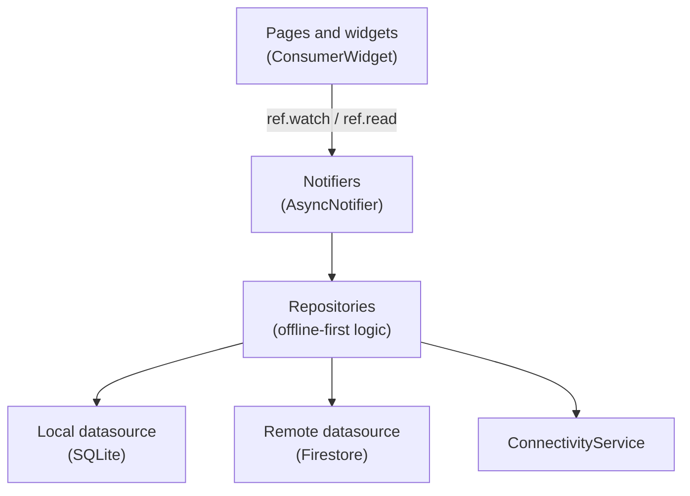
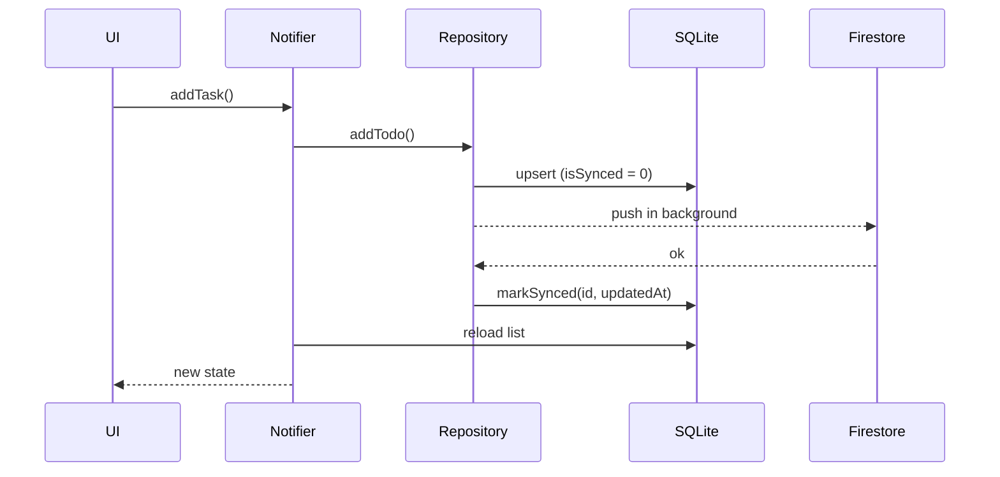
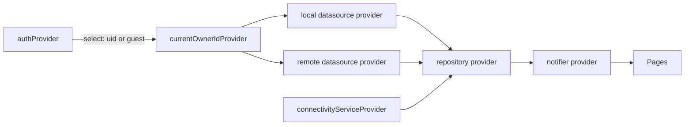

# NoteFlow

**An offline-first notes and tasks app built with Flutter, Riverpod, SQLite and Firebase.**

Every action writes to a local SQLite database first, so the app is instant and fully usable without a connection. When the user is signed in and online, changes sync to Firestore in the background. Each account on a device gets its own isolated data, and work done as a guest is adopted by the account the user signs in to.


-00A8E8)


<!-- Add a screenshot strip:  -->

---

## Contents

- [Features](#features)
- [Architecture](#architecture)
- [How sync works](#how-sync-works)
- [Per-account data on one device](#per-account-data-on-one-device)
- [Riverpod design](#riverpod-design)
- [Data model](#data-model)
- [Security](#security)
- [Tech stack](#tech-stack)
- [Getting started](#getting-started)
- [Build a release](#build-a-release)
- [Known limitations and roadmap](#known-limitations-and-roadmap)
- [Author](#author)

---

## Features

### Notes
- Rich-text editor powered by **flutter_quill**: bold, italic, underline, strikethrough, headers, lists, checklists, block quotes, inline code, links and colors.
- Category-based toolbar (Text / List / Insert / History) that keeps the writing area uncluttered.
- Eight note colors with dark-mode aware contrast.
- Pin notes to the top, grid and list views, live word count, last-updated timestamp.
- One-line content preview on each card.

### Tasks
- Low, medium and high priority with color-coded badges and an accent stripe.
- Optional description, category and due date.
- Checkbox completion with dimmed finished tasks.

### Accounts
- Email and password sign-up and sign-in.
- Google Sign-In with **account linking**: the same email can use both methods and ends up as one account.
- Add or update a password from the profile page, with re-authentication when Firebase requires a recent login.
- **Guest mode**: the app works fully without an account.

### Data and sync
- **Offline-first**: SQLite is the source of truth for the UI.
- **Two-way Firestore sync** with last-write-wins conflict resolution on `updatedAt`.
- **Soft delete with timed undo**: deleted items disappear immediately, an Undo snackbar restores them, and after the grace period the deletion is finalized.
- **Tombstone deletes**: deletions are synced as `isDeleted: true` so other devices learn about them.
- **Auto sync** when connectivity returns, on first load, on login, and through a manual sync button.
- A small cloud-off icon marks items that have not reached the server yet.

---

## Architecture

Dependencies point one way: UI → Notifier → Repository → Datasources. A lower layer never knows about a higher one.



| Layer | Responsibility |
|---|---|
| **Pages / widgets** | Render state, forward user actions. No storage or sync logic. |
| **Notifiers** | Hold UI state (`AsyncValue`), call the repository, reload the list. |
| **Repositories** | Decide when to hit local or remote storage. Own sync, undo, conflict resolution and guest adoption. |
| **Datasources** | Talk to exactly one backend each and know nothing about each other. |
| **Models** | Immutable data classes with SQLite and Firestore mappers. |

### Project structure

```
lib/
├── core/
│   ├── constants/        owner_ids.dart
│   ├── database/         database_helper.dart
│   ├── providers/        core_providers.dart
│   └── services/         connectivity_service.dart
├── features/
│   ├── notes/data/       models, datasources, repository
│   └── todo/data/        models, datasources, repository
├── presentation/
│   ├── pages/            notes, note editor, tasks, profile, auth
│   ├── providers/        auth, current owner, notes, todo, view mode
│   ├── utils/            note colors, Quill helpers
│   └── widgets/          note card, toolbar, task tile, badge, task sheet
├── home_shell.dart
└── main.dart
```

---

## How sync works



Three fields drive everything:

| Field | Purpose |
|---|---|
| `isSynced` | Has this version reached Firestore? Unsynced rows form the retry queue. |
| `updatedAt` | Which version is newer. The newest write wins. |
| `isDeleted` | Soft delete, and the tombstone that is synced to other devices. |

**Write path.** Write to SQLite, update the UI, then push in the background. If the user is a guest or offline, nothing is lost. The row stays `isSynced = 0` and is retried by the next sync.

**`markSynced` is guarded by `updatedAt`.** If the user edits an item while its previous version is still uploading, the stale upload cannot mark the new edit as synced.

**Sync run.** Push all unsynced rows, purge deletions that are confirmed, then fetch remote items and apply only those that are newer than the local copy.

**Conflict rule.** A remote item is applied if it does not exist locally (and is not a tombstone), or if its `updatedAt` is newer than the local one.

**Real-time updates.** A Firestore snapshot listener applies changes from other devices into SQLite and refreshes the UI.

---

## Per-account data on one device

Every row in `todos` and `notes` carries an `ownerId` (the Firebase uid, or `guest`). All queries filter by it. There is one set of tables, not one per user.

| Situation | Result |
|---|---|
| Guest creates tasks, then signs in | Guest rows are adopted by the account and uploaded on the next sync. |
| User A signs out, user B signs in on the same phone | B sees only B's data. A's data stays on the device, invisible. |
| A signs in again | A's data is back, including anything that had not synced yet. |

A schema migration (database version 2) adds the column and an index to existing installs, and new installs create it directly.

---

## Riverpod design

The app uses Riverpod 3 with code generation: `@riverpod` functions for dependencies and `AsyncNotifier` classes for feature state.



- **One source of truth for ownership.** `currentOwnerIdProvider` selects only the uid (or `guest`) from the auth state. Spinner or error changes never rebuild anything below it.
- **Login and logout are automatic.** When the owner changes, datasources, repository and notifier rebuild by themselves. The old repository is disposed and its listeners and timers are cancelled.
- **`keepAlive` where it matters.** Repositories own a Firestore subscription and the undo timers, and notifiers hold list state across tab switches, so they live for the whole app session.
- **`ref.watch` in `build`, `ref.read` in actions**, `ref.listen` for side effects such as syncing when connectivity returns, and `ref.mounted` before writing state after an `await`.
- **Dependency injection** through providers keeps repositories constructor-injected and easy to fake in tests.

---

## Data model

### SQLite

```
todos(id, ownerId, title, description, isCompleted, category, priority,
      dueDate, createdAt, updatedAt, isSynced, isDeleted)

notes(id, ownerId, title, content, color, category, isPinned,
      createdAt, updatedAt, isSynced, isDeleted)
```

IDs are UUID v4, so items created offline on different devices never collide. Both tables are indexed on `ownerId`.

### Firestore

```
users/{uid}                    profile
users/{uid}/todos/{todoId}
users/{uid}/notes/{noteId}
emailProviders/{email}         sign-in methods for an email, used for account linking
```

---

## Security

Publish these rules in **Firebase Console → Firestore → Rules**:

```
rules_version = '2';
service cloud.firestore {
  match /databases/{database}/documents {

    function isSignedIn() {
      return request.auth != null;
    }

    function isOwner(userId) {
      return isSignedIn() && request.auth.uid == userId;
    }

    match /users/{userId} {
      allow read, write: if isOwner(userId);

      match /todos/{todoId} {
        allow read, write: if isOwner(userId);
      }

      match /notes/{noteId} {
        allow read, write: if isOwner(userId);
      }
    }

    match /emailProviders/{email} {
      allow get: if true;
      allow list: if false;
      allow create, update: if isSignedIn()
          && request.auth.token.email != null
          && request.auth.token.email.lower() == email
          && request.resource.data.keys().hasOnly(['providers'])
          && request.resource.data.providers is list
          && request.resource.data.providers.hasOnly(['password', 'google']);
      allow delete: if false;
    }
  }
}
```

- Users can only read and write their own profile, tasks and notes. There is no catch-all rule.
- `emailProviders` exists so the app can tell, before sign-in, whether an email already uses a password or Google. Documents can be fetched by exact email but never listed, and only that email's owner can write them.
- Trade-off: someone who knows an exact email can learn which sign-in method it uses. For stronger protection, move this lookup behind a Cloud Function with rate limiting.
- Restrict your Firebase API key to your app's package name and SHA-1 fingerprints.

---

## Tech stack

| Area | Technology |
|---|---|
| Framework | Flutter, Material 3 |
| Language | Dart 3 |
| State management | `flutter_riverpod` 3, `riverpod_annotation`, `riverpod_generator` |
| Local database | `sqflite` |
| Backend | Firebase Auth, Cloud Firestore |
| Google sign-in | `google_sign_in` 7 |
| Rich text | `flutter_quill` |
| Connectivity | `connectivity_plus` |
| IDs, dates | `uuid`, `intl` |
| Code generation | `build_runner` |

---

## Getting started

### Prerequisites
- Flutter SDK (stable channel) and an Android device or emulator
- A Firebase project

### 1. Clone and install

```bash
git clone https://github.com/Faisal60177/notes_and_tasks.git
cd notes_and_tasks
flutter pub get
dart run build_runner build --delete-conflicting-outputs
```

### 2. Configure Firebase

1. Create a project in the [Firebase Console](https://console.firebase.google.com).
2. Add an Android app using this project's application ID, and register your **debug SHA-1** (and the release SHA-1 later).
3. Download `google-services.json` into `android/app/`.
4. Enable **Authentication** with the Email/Password and Google providers.
5. Create a **Firestore** database and publish the rules from the [Security](#security) section.

### 3. Set your Google web client ID

In `lib/presentation/providers/auth_notifier.dart`, replace the value of `_kWebClientId` with the **Web client ID** from Firebase Console → Authentication → Sign-in method → Google.

### 4. Run

```bash
flutter run
```

If you change a model or any `@riverpod` annotation, re-run `build_runner`. When you change the local schema, raise the database version in `database_helper.dart` and add a migration.

---

## Build a release

```bash
flutter build apk --release
flutter build appbundle --release
```

Add the **release** and **Play App Signing** SHA-1 fingerprints to your Firebase Android app, or Google sign-in will fail in release builds.

---

## Known limitations and roadmap

- [ ] Unit tests for repository conflict resolution, tombstones and guest adoption
- [ ] Email verification before treating an email as owned
- [ ] Extract an `AuthRepository` so auth logic can be tested without Firebase
- [ ] Incremental sync (only fetch changes since the last sync)
- [ ] Friendly error states with retry
- [ ] Dark theme, localization, error logging and crash reporting
- [ ] CI with `flutter analyze` and `flutter test`

Data of a signed-out account stays on the device (hidden from the app) until the app is uninstalled.

---

## Author

**Mohammad Faisal**
Flutter Mobile App Developer

[GitHub](https://github.com/Faisal60177) · [Google Play](https://play.google.com/store/apps/developer?id=Siratal+Mustaqeem)

This project is for learning and portfolio use. Add a `LICENSE` file of your choice (MIT is a common default).